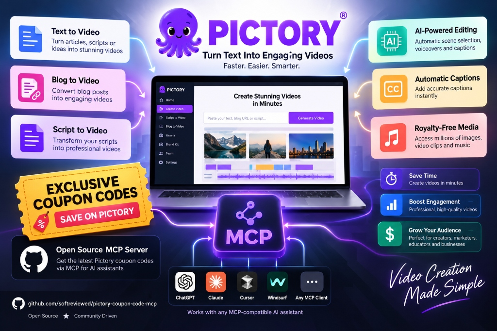

# 🎬 Pictory Coupon Code & MCP Server: Automate AI Videos (20% Off: activatecode)

[](https://modelcontextprotocol.io/)
[](https://github.com/jlowin/fastmcp)
[](https://www.python.org/)
[](https://opensource.org/licenses/MIT)
[](https://www.docker.com/)
[-orange.svg?style=for-the-badge&logo=tag)](https://softreviewed.blob.core.windows.net/softreviewed/softreviewed/uncategorized/pictory-coupon-code-2026-activatecode-discount.html)

<p align="center">
  
</p>

A universal, production-grade **Model Context Protocol (MCP)** server for [Pictory.ai](https://pictory.ai?ref=activatecode). Connects modern AI assistants and coding agents (**Claude Desktop, Cursor IDE, Cline, Roo Code, Windsurf, ChatGPT, Antigravity**) directly to the complete Pictory cloud video generation studio.

Transform scripts or articles into rendered videos, repurpose long-form podcasts into viral short clips (Reels/Shorts/TikToks), overlay realistic AI presenter avatars, search millions of stock B-roll assets, synchronize templates with your Pictory web dashboard, and publish directly to Vimeo and Amazon S3.

---

## ⚡ What This MCP Does (At a Glance)

```
                       ┌─────────────────────────┐
                       │ Any AI Assistant / Agent│
                       │(Claude, Cursor, Antigrav)│
                       └────────────┬────────────┘
                                    │ (JSON-RPC stdio)
                       ┌────────────▼────────────┐
                       │       pictory-mcp       │
                       │ FastMCP Universal Server│
                       └────────────┬────────────┘
                                    │
   ┌───────────────┬────────────────┼───────────────┬────────────────┐
   ▼               ▼                ▼               ▼                ▼
pictory_video  pictory_transcribe pictory_assets pictory_projects pictory_integrations
- Script/Render - Long Video Trans - Stock Search  - Web Sync CRUD  - Vimeo Publish
- Storyboard    - Viral AI Shorts  - Music & Mood  - Master Brand   - AWS S3 Storage
- Avatar Overlay- Timed Subtitles  - 300+ Voices     Templates      - Quotas & Usage
- Scene Patching- Highlight Clips  - AI Studio Gen - Scene Patches  - Job Cleanup
```

---

## 🚀 Quickstart (1-Minute Setup)

### 1. Get Your Pictory API Key & Exclusive Community Discount

To use this MCP server, you need a Pictory account and API key.

> [!TIP]
> ### 🎁 Exclusive Community Perk: Save ~60% with Verified Coupon Code
> If you are setting up or upgrading your Pictory account, you can combine Pictory's **40% annual subscription discount** with our verified partner coupon code **`activatecode`** for an extra **20% recurring discount** (saving up to $94/year):
> 
> * **Verified Coupon Code:** `activatecode`
> * **Direct Activation Link:** [Activate 20% Off Pictory AI](https://pictory.ai?ref=activatecode)
> * **Step-by-Step Checkout Guide:** For exact walkthrough steps on how to stack the 40% annual discount with the promo code, read our in-depth [Pictory Coupon Code & Stacking Guide](https://softreviewed.blob.core.windows.net/softreviewed/softreviewed/uncategorized/pictory-coupon-code-2026-activatecode-discount.html).
> 
> *Once subscribed, navigate to **Settings** → **API Access** (or visit [https://app.pictory.ai/api-access](https://app.pictory.ai/api-access?ref=activatecode)) and copy your API key.*

---

### 2. Connect to Your AI Client

#### 🟣 Option A: Claude Desktop
Add to your `claude_desktop_config.json`:
* **macOS:** `~/Library/Application Support/Claude/claude_desktop_config.json`
* **Windows:** `%APPDATA%\Claude\claude_desktop_config.json`

```json
{
  "mcpServers": {
    "pictory": {
      "command": "uvx",
      "args": ["pictory-mcp"],
      "env": {
        "PICTORY_API_KEY": "pictai_your_api_key_here"
      }
    }
  }
}
```

#### 🔵 Option B: Cursor IDE
1. Open **Settings** → **Features** → **MCP Servers**.
2. Click **+ Add New MCP Server**.
3. Name: `pictory`
4. Type: `command`
5. Command: `uvx pictory-mcp`
6. Environment variable: `PICTORY_API_KEY=pictai_your_api_key_here`

#### 🟠 Option C: Cline (VS Code Extension)
In VS Code with the [Cline](https://github.com/cline/cline) extension:
1. Open the Cline panel → Click the **MCP Servers** icon (plug icon).
2. Click **Configure MCP Servers** (or open `%APPDATA%\Code\User\globalStorage\saoudrizwan.claude-dev\settings\cline_mcp_settings.json`).
3. Add the `pictory` configuration:
```json
{
  "mcpServers": {
    "pictory": {
      "command": "uvx",
      "args": ["pictory-mcp"],
      "env": {
        "PICTORY_API_KEY": "pictai_your_api_key_here"
      },
      "disabled": false,
      "autoApprove": []
    }
  }
}
```

#### 🦘 Option D: Roo Code (VS Code Extension)
In VS Code with [Roo Code](https://github.com/RooVetGit/Roo-Code):
1. Open Roo Code settings → **MCP Servers** tab.
2. Edit `cline_mcp_settings.json` (stored in `%APPDATA%\Code\User\globalStorage\rooveterinaryinc.roo-cline\settings\cline_mcp_settings.json`):
```json
{
  "mcpServers": {
    "pictory": {
      "command": "uvx",
      "args": ["pictory-mcp"],
      "env": {
        "PICTORY_API_KEY": "pictai_your_api_key_here"
      }
    }
  }
}
```

#### 🌊 Option E: Windsurf (Codeium)
Add to your `~/.codeium/windsurf/mcp_config.json`:
```json
{
  "mcpServers": {
    "pictory": {
      "command": "uvx",
      "args": ["pictory-mcp"],
      "env": {
        "PICTORY_API_KEY": "pictai_your_api_key_here"
      }
    }
  }
}
```

#### ⚙️ Option F: OpenCode & Continue.dev
In `~/.continue/config.json`:
```json
{
  "experimental": {
    "modelContextProtocolServers": [
      {
        "transport": {
          "type": "stdio",
          "command": "uvx",
          "args": ["pictory-mcp"],
          "env": {
            "PICTORY_API_KEY": "pictai_your_api_key_here"
          }
        }
      }
    ]
  }
}
```

#### 🐳 Option G: Docker MCP Gateway
Add to `custom.yaml` or run directly:
```bash
docker mcp server enable pictory
```

---

## 🛠️ Master Tool Reference (5 Consolidated Tools)

| Tool | Category | Key Supported Actions |
| :--- | :--- | :--- |
| `pictory_video` | Video Rendering & Editing | `render_storyboard`, `create_preview`, `render_from_preview`, `render_with_modifications`, `update_elements`, `render_project`, `poll_job` |
| `pictory_transcribe` | Transcription & Viral Clips | `transcribe_video`, `poll_transcription`, `automatic_highlights`, `custom_highlights`, `get_subtitles` |
| `pictory_assets` | Stock & AI Asset Engine | `search_media`, `search_music`, `list_music_genres`, `list_music_moods`, `list_avatars`, `list_voiceovers`, `list_styles`, `list_fonts`, `generate_ai_image`, `generate_ai_video`, `get_signed_url` |
| `pictory_projects` | Project & Template Sync | `list_projects`, `get_project`, `update_project`, `delete_project`, `list_templates`, `get_template`, `create_template`, `update_template`, `delete_template`, `update_scene` |
| `pictory_integrations`| Cloud & Account Ops | `get_quota`, `get_aicredits_usage`, `list_vimeo_connections`, `create_vimeo_connection`, `list_aws_connections`, `create_aws_connection`, `clean_job` |

---

## 💡 Practical Automation Use Cases & Workflows

Here are 5 real-world automation blueprints you can build immediately with this MCP server:

### 🌟 1. Automated Blog-to-Video Pipeline (Content Repurposing)
```
New Blog Post URL ──▶ Pictory MCP (Scrapes & Summarizes) ──▶ Matches Getty B-Roll + Voiceover ──▶ 1080p MP4 Ready
```
* **How it works:** When a new article is published on WordPress or Ghost, your agent calls `pictory_video` with `"blogUrl": "https://yoursite.com/article"`. Pictory automatically reads the article, extracts the core talking points, generates a multi-scene storyboard, matches Storyblocks B-roll for each sentence, and overlays a synchronized talking-head presenter avatar.
* **Result:** Repurpose 1 written article into a professional YouTube video in under 3 minutes with zero video editing software.

---

### 🌟 2. Long Video to Viral Shorts & Reels Generator (9:16)
```
Long Podcast/Webinar ──▶ pictory_transcribe ──▶ AI Engagement Scoring ──▶ Vertical Clip + Karaoke Captions
```
* **How it works:** Pass an existing YouTube video or webinar recording URL to `pictory_transcribe` (`action="transcribe_video"` with `max_duration=60`). Pictory transcribes the full audio, runs sentiment and engagement analysis to detect the most captivating moments, and slices them into 60-second vertical (9:16) clips with dynamic, word-by-word highlighted captions.
* **Result:** Generate 5-10 high-converting TikToks, Instagram Reels, and YouTube Shorts from a single podcast.

---

### 🌟 3. Autonomous "Faceless" YouTube Channel Engine
```
AI Writes Script ──▶ pictory_assets (Curate Music & Footage) ──▶ pictory_video (Render) ──▶ Full Video
```
* **How it works:** Your AI assistant (Claude, Cursor, or Cline) writes a compelling 5-minute educational script. The agent queries `pictory_assets` to search for thematic background music (`search_music` by genre or mood like "Inspiring" or "Cinematic") and applies a modern subtitle animation preset (`list_styles`). The agent then compiles the complete project via `render_storyboard`.
* **Result:** 100% hands-free faceless video generation for niche YouTube channels, documentation hubs, or educational tutorials.

---

### 🌟 4. Zero-Credit Scene Optimization & A/B Testing
```
create_preview (0 Credits) ──▶ Inspect Thumbnails ──▶ update_scene (Surgical Tweak) ──▶ Final Render
```
* **How it works:** Before rendering, call `pictory_video` (`action="create_preview"`). This gives you complete scene breakdown, thumbnail URLs, and duration timings **without consuming any of your monthly render minutes**. If Scene 2 needs a different hook or Scene 4 needs a different B-roll clip, use `pictory_projects` (`action="update_scene"`) to surgically swap it before triggering the final render.
* **Result:** Eliminates wasted credits and lets you A/B test different hooks and titles risk-free.

---

### 🌟 5. Enterprise S3 & Vimeo Auto-Publishing Pipeline
```
Video Render Finished ──▶ pictory_integrations ──▶ Direct Upload to AWS S3 & Vimeo Showcase
```
* **How it works:** Connect your enterprise cloud infrastructure once using `create_aws_connection` or `create_vimeo_connection`. Whenever a video rendering job finishes, Pictory automatically publishes the high-bitrate MP4 directly into your private AWS S3 bucket or Vimeo channel.
* **Result:** Complete end-to-end automation from raw text prompt to cloud-hosted streaming delivery.

---

## 💡 Example: URL-to-Video with Talking-Head Avatar

Give Pictory a public URL and an avatar configuration — it will automatically scrape the content, generate scenes, match stock B-roll, and overlay a synchronized talking-head presenter:

```json
{
  "videoName": "Article_Showcase",
  "aspectRatio": "16:9",
  "avatar": {
    "avatarId": "Brandon_expressive2_public",
    "position": "bottom-right",
    "width": "25%",
    "borderRadius": "100"
  },
  "voiceOver": {
    "enabled": true,
    "aiVoices": [{"speaker": "Martin", "speed": 100, "volume": 100}]
  },
  "backgroundMusic": {
    "enabled": true,
    "autoMusic": true,
    "volume": 0.12
  },
  "scenes": [
    {
      "blogUrl": "https://softreviewed.com/openai-gpt6-astra-benchmarks/"
    }
  ]
}
```

---

## ❓ Frequently Asked Questions & Developer Guide (Complete FAQ)

Every question below was answered and verified during live API integration and test runs on the Pictory API v2 production engine:

### 1. Can I turn a blog/website URL into a video with stock footage AND a talking head?
**Yes, absolutely!** When you specify `"blogUrl": "https://your-site.com/article"` in a scene, Pictory automatically:
1. Scrapes the article text and summarizes key takeaways into individual scenes.
2. Searches Getty Images & Storyblocks to match dynamic B-roll video for every sentence.
3. Overlays the synchronized talking-head AI avatar (`avatarId`) with real-time lip sync and voice narration across all scenes.

### 2. How can I review scenes before spending my video render credits?
Use `pictory_video` with `action="create_preview"`. This generates a **Storyboard Preview Job** that returns scene thumbnails, text breakdowns, and timings **without deducting render minutes**. Once you review and approve the preview, call `action="render_from_preview"` with the `job_id` to render the final 1080p MP4.

### 3. How do I make surgical changes to an individual scene without re-rendering everything?
You can edit scenes at any time using:
* `pictory_video` (`action="update_elements"`): Send a partial JSON array containing only the scene elements (text, background URL, duration, or font) you wish to modify.
* `pictory_projects` (`action="update_scene"`): Target an exact `project_id` and `scene_number` to swap background media or edit the script line while leaving all other scenes untouched.

### 4. Does editing scenes or previewing videos cost credits?
**No!** Editing scene text, swapping background assets, adjusting durations, and generating storyboard previews are **100% free** and deduct **zero** video render minutes. Credits are only consumed when a final video is rendered into an MP4 file on Pictory's cloud servers.

### 5. What is the difference between Video Search (`search_media`) and Video Render (`render_storyboard`)?
* **`search_media` (Stock Search):** Instantly searches Storyblocks and Getty Images catalogs for stock video footage and returns preview URLs and metadata for inspection.
* **`render_storyboard` (Video Render):** Submits a complete multi-scene composition (text, narration audio, avatar, background B-roll, subtitles, and music) to Pictory's cloud rendering engine to stitch everything into a polished 1080p/4K MP4.

### 6. Can projects created via MCP be viewed and edited in the official Pictory web dashboard?
**Yes, 100%!** Every storyboard created through this MCP server produces a legitimate `project_id`. You can call `pictory_projects` (`action="get_project"`) or simply log into [app.pictory.ai](https://app.pictory.ai?ref=activatecode) to see your project synchronized in real time. Any change made in the web UI reflects in the API, and vice-versa.

### 7. How do I customize avatar positioning, circular bubbles, and styling?
The top-level `avatar` object gives you complete layout control:
* **Position:** `"bottom-right"`, `"bottom-left"`, `"center"`, `"top-right"`, `"top-left"`.
* **Width:** `"25%"` (floating corner bubble), `"50%"` (split-screen presenter), or `"100%"` (full-screen talking head).
* **Border & Shape:** Set `"borderRadius": "100"` for a circular bubble or `"0"` for square. Add `"borderThickness": 3` and `"borderColor": "rgba(255,255,255,1)"` for a crisp white outline.

### 8. Does Pictory support generative AI models (like PixVerse, Stable Diffusion), and how are credits handled?
**Yes!** Through `pictory_assets`:
* **AI Video:** Generate custom B-roll clips with PixVerse (`action="generate_ai_video"`).
* **AI Images:** Generate custom photorealistic images with Recraft or Stable Diffusion (`action="generate_ai_image"`).
* **Credit Pool:** AI Studio generations consume your account's monthly **AI Credits** pool, which is tracked separately from your **Video Render Minutes** pool. Check both anytime using `pictory_integrations` (`action="get_aicredits_usage"` and `action="get_quota"`).

### 9. How does background music work, and does it interfere with voiceover?
Pictory features intelligent **audio auto-ducking**. When you enable `backgroundMusic` alongside an AI `voiceOver` track, Pictory dynamically lowers the music volume (to ~10-15%) whenever the narrator speaks, and gently swells the volume during natural pauses. You can also search thousands of tracks by mood and genre (`pictory_assets` -> `search_music`).

### 10. Can I turn long YouTube videos or podcasts into viral short clips (Shorts/Reels/TikToks)?
**Yes!** Call `pictory_transcribe` with `action="transcribe_video"` and specify a target `max_duration` (e.g., 60 seconds). Pictory transcribes the audio, detects the most viral and engaging hooks using sentence scoring, and outputs vertical (9:16) clips with dynamic word-by-word highlighted captions.

### 11. What is the critical API quirk with highlight extraction (`jobId` in path)?
In the official Pictory API v2, highlight extraction endpoints (`GET /v2/transcription/highlights/{jobId}`) require the `jobId` to be provided in the **URL path**, not within the JSON request body. This MCP server handles this URL parameter mapping automatically so you never encounter 404 or 400 parameter errors.

### 12. Can Pictory export rendered videos directly to private cloud storage or Vimeo?
**Yes!** Through `pictory_integrations`:
* **Vimeo Integration:** Connect your Vimeo account (`create_vimeo_connection`) to automatically push finished videos to Vimeo.
* **AWS S3 Storage:** Connect your private AWS S3 bucket (`create_aws_connection`) to automatically archive high-resolution MP4s directly to your own enterprise cloud infrastructure.

### 13. How do I get the maximum discount with the Pictory coupon code?
Stack Pictory's built-in 40% annual billing discount with our exclusive community coupon code **`activatecode`** to receive an effective **~60% total discount** (saving up to $94/year). For a complete checkout walkthrough and plan pricing comparison, read our in-depth [Pictory Coupon Code 2026 Stacking Guide](https://softreviewed.blob.core.windows.net/softreviewed/softreviewed/uncategorized/pictory-coupon-code-2026-activatecode-discount.html).

---

## 🧪 Testing & Verification

Run the test suite locally:
```bash
pytest tests/
```
All 17 unit tests validate payload serialization, error handling, route matching, and header authentication.

---

## 🤝 Support, Bug Reports & Custom Automations

* 🐛 **Found a bug or API quirk?** Open an issue on our [GitHub Issues Tracker](https://github.com/softreviewed/pictory-coupon-code-mcp/issues).
* 💼 **Need custom AI video automations, enterprise deployment, or priority bug fixes?** Reach out to us directly via [SoftReviewed Contact](https://softreviewed.com/contact/).


## 📄 License
MIT License. Free for personal, commercial, and enterprise integration.
